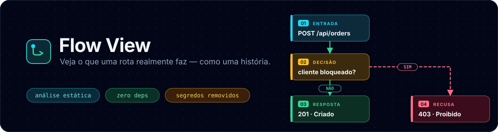
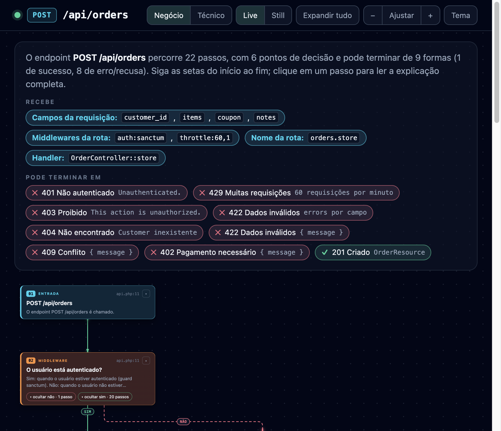
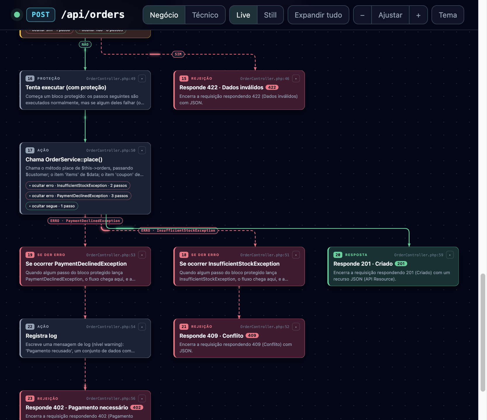
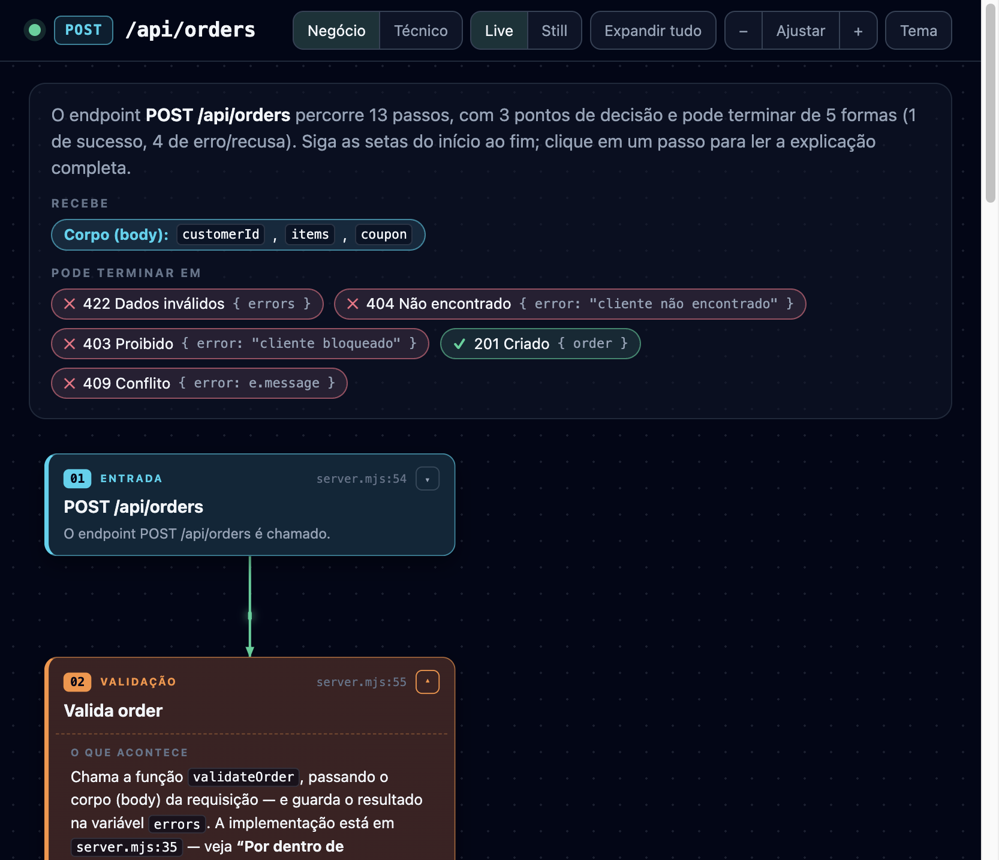
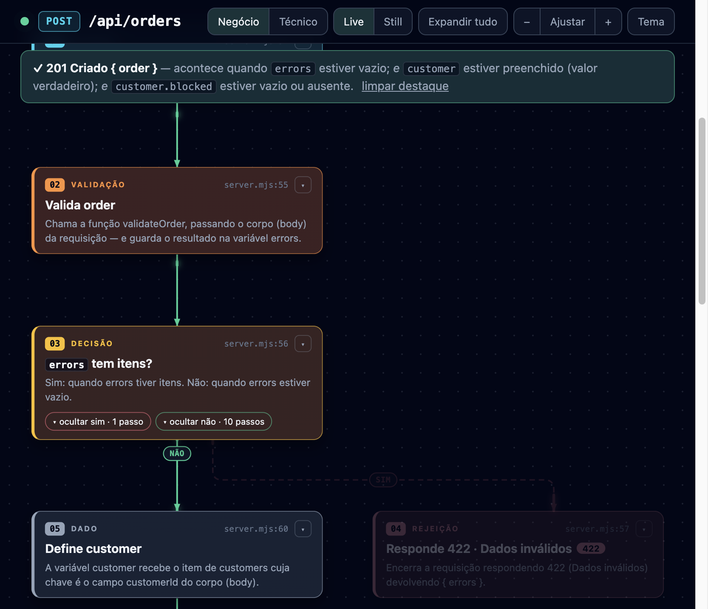
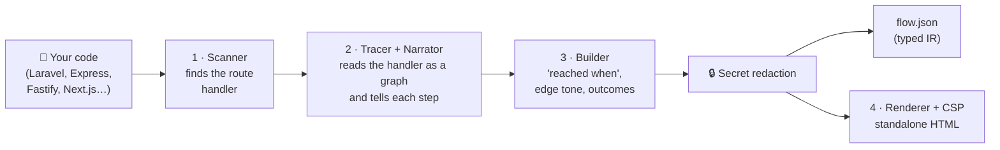

<div align="center">



<br>

[](https://github.com/jadsgithub/flow-view/actions/workflows/ci.yml)
[](https://github.com/jadsgithub/flow-view/actions/workflows/codeql.yml)
[](https://scorecard.dev/viewer/?uri=github.com/jadsgithub/flow-view)
[](https://github.com/jadsgithub/flow-view/releases)
[](./LICENSE)
[](https://nodejs.org)
[](./package.json)
[](https://semver.org)
[](https://www.conventionalcommits.org)
[](./CONTRIBUTING.md)

[🇧🇷 Português](./README.md) · **🇺🇸 English**

</div>

---

**Flow View** turns **a route/endpoint** of your project into an **interactive HTML story**: what it receives, which rules and validations it applies, which functions it calls (and what each one does inside) and in how many ways the request can end.

It is built for people who code **and** people who don't: the same diagram has a **Business mode** (plain language) and a **Technical mode** (functions, classes, variables, file and line).

**Primary stack: PHP / Laravel** (routes, middleware, `FormRequest`, controllers, services, Eloquent, exceptions, queues). Express, Fastify, Hono, Next.js, FastAPI, Flask and Gin also work. **Primary usage: as an agent skill** (Cursor, Claude Code, Codex); CLI and npm are alternatives.

> **Note:** the narrative inside the generated diagram is currently written in **Brazilian Portuguese**. English narration is on the [roadmap](#roadmap). The CLI, documentation, and `flow.json` schema are language-neutral.

## Contents

- [See it in action](#see-it-in-action)
- [Why use it](#why-use-it)
- [Quick start](#quick-start)
- [Agent skill (primary usage)](#agent-skill-primary-usage)
- [PHP / Laravel](#php--laravel)
- [How it works](#how-it-works)
- [CLI reference](#cli-reference)
- [Language and framework support](#language-and-framework-support)
- [🔐 Security](#-security)
- [Versioning and releases](#versioning-and-releases)
- [Development](#development)
- [Roadmap](#roadmap)
- [Contributing](#contributing)
- [License](#license)

## See it in action

<p align="center">
  
  
</p>

<p align="center">
  
  
</p>

## Why use it

| Who | What they get |
| --- | ------------- |
| 👩‍💻 **Developers** | Understand an unfamiliar route in minutes: branches, validations, calls and returns, with file and line for every step |
| 🧪 **QA** | See **every outcome** of an endpoint and *when* each happens, the basis for test cases |
| 🧑‍💼 **Product / Business** | Read and validate **business rules** without reading code |
| 🤖 **AI agents** | A reliable, deterministic map of the flow instead of guessing across dozens of files |

**Principles:** local and private (no network, no telemetry) · static analysis (the analyzed code is **never executed**) · deterministic (no LLM) · **zero dependencies** · a single self-contained HTML file named after the endpoint.

## Quick start

**Requirements:** [Node.js](https://nodejs.org) 18+. Tested on macOS and Linux in CI; Windows should work but is not covered by CI yet.

### 1) As an agent skill (recommended)

Install once, then ask your agent in plain language, the way you use Archify:

```bash
# 1. clone the version you want (recommended: a tag) and review the contents
git clone --branch v0.3.0 https://github.com/jadsgithub/flow-view.git
cd flow-view

# 2. installs the skill into ~/.agents/skills/flow-view (read by Cursor and Codex)
bash install.sh            # or: bash install.sh all  (+ shortcuts for Cursor, Claude Code and OpenCode)
```

Then, inside your Laravel project, tell the agent:

> **Use Flow View and show me the flow of `POST /api/orders`.**

The agent asks where to save (default: the project folder; or Desktop / another path), writes `.flow-view/post-api-orders-<date>/post-api-orders-<date>.html` and summarizes the outcomes.

### 2) From the terminal (CLI)

```bash
node flow-view/bin/flow-view.mjs --root examples/laravel-app --method POST --path /api/orders

# your own project
node /path/to/flow-view/flow-view/bin/flow-view.mjs --root ~/my-project --list-routes
node /path/to/flow-view/flow-view/bin/flow-view.mjs --root ~/my-project --method POST --path /api/checkout
# save outside the project
node /path/to/flow-view/flow-view/bin/flow-view.mjs --root ~/my-project --method POST --path /api/checkout --out ~/Desktop
```

<details>
<summary><b>Want a <code>flow-view</code> command available everywhere?</b></summary>

```bash
npm link          # inside the cloned repository (downloads nothing)
flow-view --version
```

</details>

## Agent skill (primary usage)

Flow View ships as a **self-contained skill** ([`SKILL.md`](./SKILL.md) + `flow-view/`), the same model as Archify: the agent reads `SKILL.md`, runs the CLI through the installed folder's absolute path and delivers the result.

**Agent workflow**

1. Ask where to save the diagram, if you have not said yet (default: the project folder; otherwise `--out` at the chosen path).
2. `flow-view --root . --list-routes --json` — discover routes (Laravel) when the request has no exact method + path.
3. `flow-view --root . --method POST --path /api/orders --json` — generate the diagram and print **only** a JSON receipt (no browser).
4. Reply with the HTML link (named after the endpoint), the summary (steps, decisions, outcomes) and, if you asked for an explanation, a business-language recap read from `flow.json`.

Each request gets its own folder `.flow-view/<method>-<route>-<YYYYMMDD-HHMMSS>/` **or** the destination you choose with `--out` (add `.flow-view/` to `.gitignore` if you save inside the project). The HTML file uses the same name as the folder: `post-api-orders-20261107-172702.html`.

```bash
bash install.sh              # ~/.agents/skills/flow-view  (Cursor and Codex read from here)
bash install.sh all          # + shortcuts: ~/.cursor, ~/.claude and ~/.config/opencode
bash install.sh --link       # development mode: points at the clone (no copy)
bash install.sh uninstall    # remove everything
```

`install.sh` **only copies local files**: no network, no downloads, no code execution. **Avoid `curl | bash`**: clone, check the tag and run it locally. The CLI and npm keep working as before.

## PHP / Laravel

Flow View reads the project **the way Laravel executes it**, without running `php`, `artisan` or `composer`:

| Stage (real order) | What shows up in the diagram |
| ------------------ | ---------------------------- |
| **Routes** (`routes/*.php`) | groups, `prefix`, `name`, `apiResource`/`resource`, `Route::view`/`redirect`, closures, invokable controllers, `where`, middleware |
| **Middleware** | `auth`/`auth:sanctum` (401), `throttle` (429), `can:` (403), `verified`, `role:`/`permission:`, `Kernel`/`bootstrap/app.php` aliases and **custom middleware** (`handle()` is read and narrated) |
| **Route model binding** | `{order}` → `Order`, 404 when missing |
| **FormRequest** | `prepareForValidation` → `authorize()` (403) → `rules()` (422 for APIs; redirect for web), with a **per-field summary** |
| **Controller** | `if/elseif/else`, `switch`, loops, `try/catch/finally` with **exception-typed arrows**, `abort_if/abort_unless`, `$this->authorize()` + Policies, `$request->validate()`, `findOrFail`, `DB::transaction` |
| **Services/Actions** | resolved through constructor injection (PSR-4): "inside `OrderService::place`", up to 3 levels, including the exceptions they throw |
| **Eloquent and facades** | queries, create/update/delete, relations, `Http::`, `Cache::`, `Log::`, `Mail`/`Notification`, events and queues |
| **Responses** | `response()->json`, API Resources (fields extracted), `redirect`, `view`, `noContent`, HTTP status; exceptions mapped to HTTP (custom `render()`) |

Example (`examples/laravel-app`, `POST /api/orders`): **22 steps, 6 decisions, 9 outcomes** — 401, 429, 403, 422 (FormRequest), 404, 422, 409, 402 and 201. Limits: the analysis is static and heuristic; dynamically generated routes, `Route::macro`, package routes registered at runtime and very dynamic magic methods may be simplified.

## How it works



1. **Scanner** finds the route and handler (**Laravel** first; then Express, Fastify, Hono, Next.js App Router, FastAPI, Flask, Gin).
2. **Tracer + Narrator** read the handler as a **decision graph** (`if/else`, `switch`, loops, `try/catch/finally`, `return`/`throw`) and **narrate each step**; calls to functions/methods in the same file or via **relative imports are resolved** and summarized (up to 2 levels).
3. **Builder** computes, for each step, *when* it is reached, the tone of each edge (success / error / neutral) and the **possible outcomes**.
4. **Renderer** writes a self-contained HTML file (named after the endpoint) with a strict **Content-Security-Policy**, plus `flow.json`.

Everything is rules and static analysis: **no LLM, no network, no execution of your code**.

## CLI reference

```text
flow-view --root <dir> --method <VERB> --path <route> [options]
```

| Option | Description | Default |
| ------ | ----------- | ------- |
| `--root <dir>` | Root of the analyzed project. **Nothing outside it is read.** | `.` |
| `--method <VERB>` | `GET`, `POST`, `PUT`, `PATCH`, `DELETE`, `HEAD`, `OPTIONS` or `ANY` | `GET` |
| `--path <route>` | Route path: real (`/api/orders/42`) or pattern (`/api/orders/{order}`) | *(required)* |
| `--list-routes` | List the routes found (Laravel) and exit | — |
| `--json` | Print only a **JSON receipt** (for agents/scripts); doesn't open the browser | — |
| `--out <dir>` | Output folder (`flow.json` + HTML named after the endpoint). May be outside the project (`~/Desktop`). | `<root>/.flow-view/<method>-<route>-<date>/` |
| `--open` / `--no-open` | Force / suppress opening the browser | opens (except with `--json`) |
| `--render-only <file>` | Only render HTML from an existing `flow.json` | — |
| `-v`, `--version` | Print the version (SemVer) | — |
| `-h`, `--help` | Help | — |

**Exit codes:** `0` success · `1` invalid usage/error · `2` route not found (with `--json` the receipt has `"ok": false` and the error suggests similar routes).

## Language and framework support

| Language / Framework | Finds the route | Step-by-step narrative |
| -------------------- | :-------------: | ---------------------- |
| **PHP / Laravel** (primary stack) | ✅ `routes/*.php` (groups, resources, middleware) | ✅ **Full**: middleware, route model binding, `FormRequest` (authorize/rules), controller, injected services, Eloquent, typed `try/catch`, Policies, transactions, queues, API Resources and exceptions → HTTP |
| **JavaScript / TypeScript**: Express, Fastify, Hono, Next.js (App Router) | ✅ | ✅ **Full**: conditions, `else`, `switch`, loops, `try/catch/finally`, assignments, resolved calls |
| **Python**: FastAPI, Flask | ✅ | 🟡 Basic |
| **Go**: Gin | ✅ | 🟡 Basic |

The analysis is **heuristic** (nothing is compiled or executed); very dynamic constructs may produce a simplified diagram.

## 🔐 Security

Flow View reads code that may come from third parties and produces a file you will probably share, so security is part of the design. **It is public, but secure by default:**

| Risk | Mitigation |
| ---- | ---------- |
| Analyzed code trying to run something | **100% static analysis**: analyzed code is never executed |
| Reading files outside the project (`../`, symlinks) | All reads validated with `realpath` and **restricted to `--root`**; symlinks are not followed |
| Pathological input (huge files, catastrophic regex) | Size/count/depth limits; route patterns **escaped** before becoming a regex |
| Malicious code turning into HTML (XSS) | All text is **escaped**; embedded data is safe JSON; class names via allow-list |
| Defense in depth against XSS | **CSP**: `default-src 'none'`, scripts only by **SHA-256 hash**, `connect-src 'none'`, no external resources |
| Hard-coded secrets leaking into the HTML | **Automatic redaction** of API keys (AWS, GitHub, Slack, Google, Stripe…), JWTs, private keys, URLs with passwords and `password = "…"` |
| PHP parser reading what it shouldn't | Own static parser (no `php`/`artisan`/`composer`); `vendor/` ignored; class resolution confined to the root (PSR-4 + `isInside`); pathologically nested files skipped and at most 2,000 steps per diagram |
| Malicious dependency (supply chain) | **Zero dependencies**; no install scripts; Actions pinned by **SHA**; Dependabot; CodeQL; OpenSSF Scorecard |
| Tampered release | Releases only from `main`, with **SLSA provenance** and `SHA256SUMS` |
| Prompt injection against AI agents | The skill tells agents to treat code content as **data**, not instructions |

> ⚠️ **Before sharing the HTML:** it contains **snippets of your code**. Secret redaction is a heuristic safety net, not a guarantee.

**Found a vulnerability?** Please don't open a public issue: use [private reporting](https://github.com/jadsgithub/flow-view/security/advisories/new). See the [Security Policy](./SECURITY.md) and the [Threat Model](./docs/threat-model.md).

```bash
gh attestation verify flow-view-X.Y.Z.tgz --repo jadsgithub/flow-view   # provenance (SLSA)
sha256sum -c SHA256SUMS                                                 # integrity
```

## Versioning and releases

- **[SemVer 2.0.0](https://semver.org)**. While on `0.x`, breaking changes may land in *minor* releases (always listed in the changelog).
- **[Conventional Commits](https://www.conventionalcommits.org)** drive the kind of version bump.
- **[CHANGELOG.md](./CHANGELOG.md)** follows [Keep a Changelog](https://keepachangelog.com).
- **Single source of truth**: `package.json`. CI fails if it diverges from `.cursor-plugin/plugin.json`, `CHANGELOG.md` or the **tag**.
- **Signed, immutable tags** `vX.Y.Z`; each tag produces a **GitHub Release** with `flow-view-X.Y.Z.tgz`, `SHA256SUMS` and a provenance attestation.
- **Traceability**: every `flow.json` records `meta.generator`, every generated HTML file carries `<meta name="generator" content="flow-view X.Y.Z">`.
- `main` is **protected** (required PR, green CI, signed commits, linear history, no force-push).

Maintainer process: [docs/releasing.md](./docs/releasing.md).

## Development

No dependencies, just Node.js 18+.

```bash
npm run verify    # repo checks (syntax, versions, placeholders) + tests
npm test          # tests only (node:test)
npm run demo      # generate the sample diagram (Express)
npm run demo:laravel   # generate the sample Laravel diagram
```

## Roadmap

- [x] **PHP/Laravel** (routes, middleware, `FormRequest`, controllers, services, Eloquent)
- [ ] Laravel: Livewire/Inertia, package routes registered at runtime, more Policies/Gates
- [ ] NestJS, Koa and Symfony
- [ ] Full narrative for **Python** and **Go**
- [ ] **English** (and other languages) narration
- [ ] Export to **SVG/PNG/PDF**
- [ ] **npm** publishing with provenance
- [ ] **Windows** CI
- [ ] More secret-detection patterns

## Contributing

Contributions are very welcome! Read [CONTRIBUTING.md](./CONTRIBUTING.md) (setup, Conventional Commits, signed commits, security rules) and the [Code of Conduct](./CODE_OF_CONDUCT.md).

## License

Released under the **MIT** license. See [LICENSE](./LICENSE).
