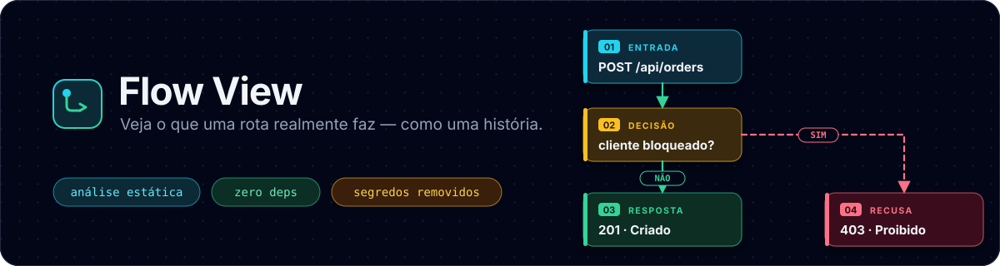
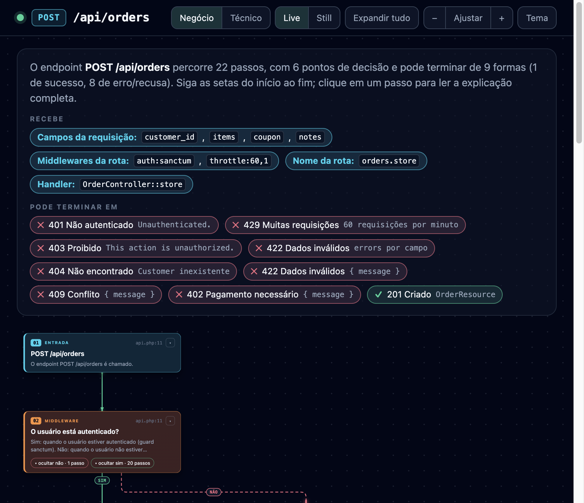
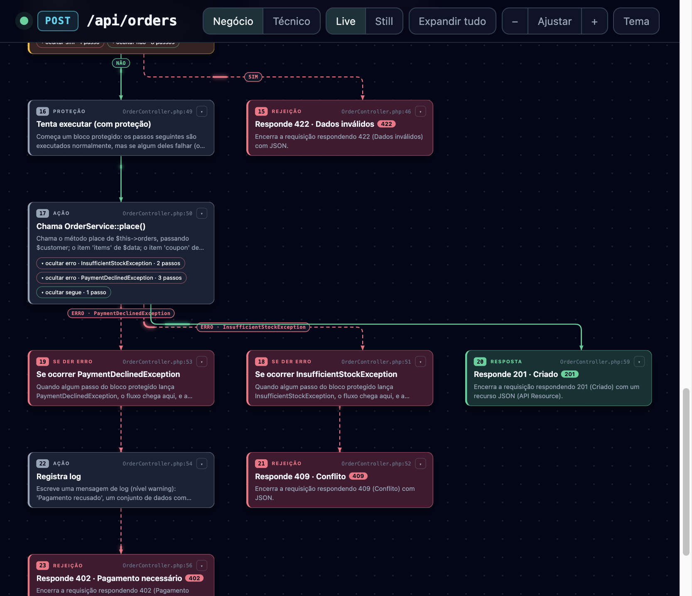
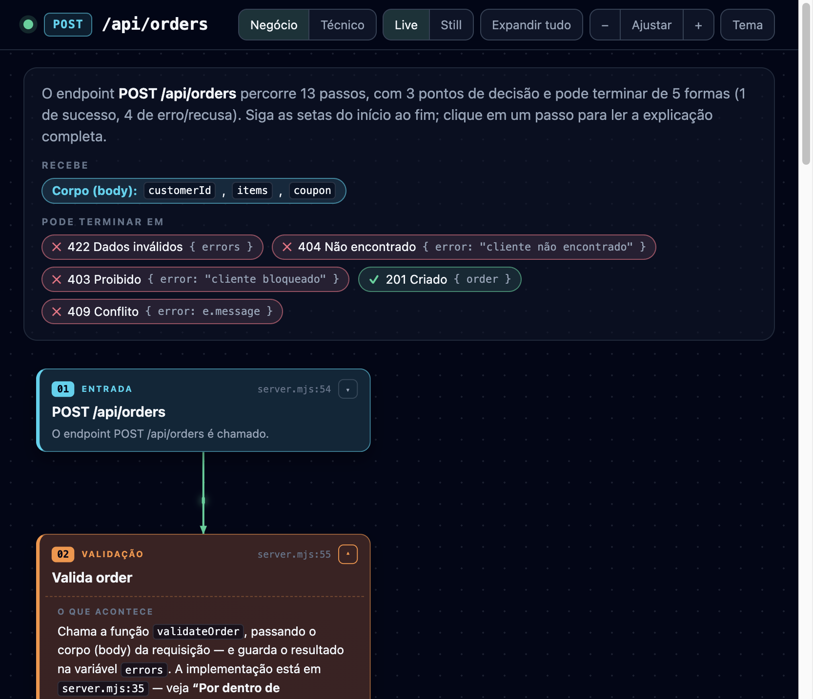
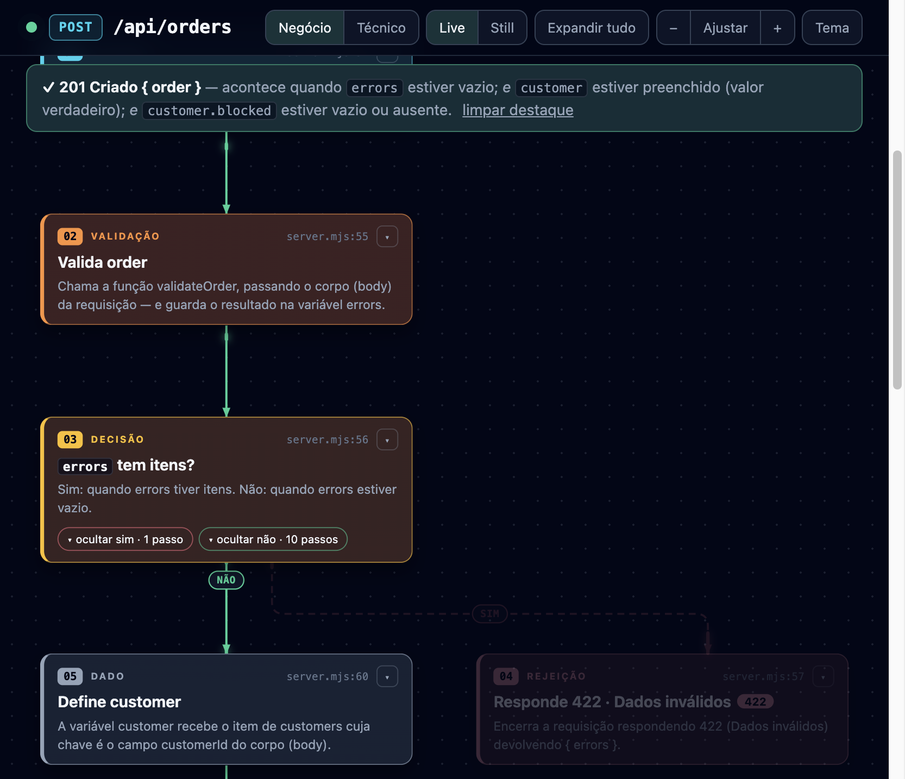
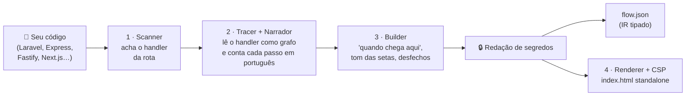

<div align="center">



<br>

[](https://github.com/jadsgithub/flow-view/actions/workflows/ci.yml)
[](https://github.com/jadsgithub/flow-view/actions/workflows/codeql.yml)
[](https://scorecard.dev/viewer/?uri=github.com/jadsgithub/flow-view)
[](https://github.com/jadsgithub/flow-view/releases)
[](./LICENSE)
[](https://nodejs.org)
[](./package.json)
[](https://semver.org/lang/pt-BR/)
[](https://www.conventionalcommits.org/pt-br/)
[](./CONTRIBUTING.md)

**🇧🇷 Português** · [🇺🇸 English](./README.en.md)

</div>

---

**Flow View** transforma **uma rota/endpoint** do seu projeto em uma **história interativa em HTML**: o que ele recebe, quais regras e validações aplica, quais funções chama (e o que cada uma faz por dentro) e de quantas formas a requisição pode terminar.

Foi pensado para quem programa **e** para quem não programa: o mesmo diagrama tem um **modo Negócio** (linguagem simples) e um **modo Técnico** (funções, classes, variáveis, arquivo e linha).

> *"O endpoint `POST /api/orders` passa por `auth:sanctum` e `throttle`, valida `customer_id` e `items` no `StoreOrderRequest` (403 se `authorize()` recusar, 422 se algum campo for inválido), busca o `Customer` (404 se não existir), cria o pedido em `OrderService::place` dentro de uma transação e responde 201 — ou 409/402 se faltar estoque ou o pagamento for recusado."*
> Isso, mas desenhado, clicável e gerado **a partir do código real**, sem IA e sem enviar nada para lugar nenhum.

**Stack principal: PHP / Laravel** (rotas, middlewares, `FormRequest`, controllers, services, Eloquent, exceções, filas). Também funciona com Express, Fastify, Hono, Next.js, FastAPI, Flask e Gin. **Uso principal: como skill de agente** (Cursor, Claude Code, Codex), com CLI e npm como alternativas.

## Sumário

- [Veja em ação](#veja-em-ação)
- [Por que usar](#por-que-usar)
- [Início rápido](#início-rápido)
- [Skill para agentes (uso principal)](#skill-para-agentes-uso-principal)
- [PHP / Laravel](#php--laravel)
- [Como funciona](#como-funciona)
- [Usando o diagrama](#usando-o-diagrama)
- [Referência do CLI](#referência-do-cli)
- [Suporte de linguagens e frameworks](#suporte-de-linguagens-e-frameworks)
- [🔐 Segurança](#-segurança)
- [Versionamento e releases](#versionamento-e-releases)
- [Estrutura do repositório](#estrutura-do-repositório)
- [Desenvolvimento](#desenvolvimento)
- [Roadmap](#roadmap)
- [Contribuindo](#contribuindo)
- [Licença](#licença)

## Veja em ação

<p align="center">
  
  
</p>

<sub>Gerado de <code>examples/laravel-app</code> (<code>POST /api/orders</code>). À esquerda: o resumo, o que a rota recebe, os middlewares e os 9 desfechos. À direita: o <code>try/catch</code> do controller, com setas por tipo de exceção levando a 409 e 402, e o caminho de sucesso (201).</sub>

<p align="center">
  
  
</p>

<sub>O mesmo viewer com o app Express (<code>examples/sample-app</code>): ao clicar em um desfecho (aqui, <b>201 Criado</b>), o caminho até ele é destacado e o banner explica <i>quando</i> isso acontece.</sub>

## Por que usar

| Para quem | O que ganha |
| --------- | ----------- |
| 👩‍💻 **Devs** | Entendem uma rota desconhecida em minutos: ramos, validações, chamadas e retornos, com arquivo e linha de cada passo |
| 🧪 **QA** | Enxergam **todos os desfechos** de um endpoint e *quando* cada um acontece, a base para casos de teste |
| 🧑‍💼 **Produto / Negócio** | Leem e validam **regras de negócio** sem ler código |
| 🧭 **Quem chega ao projeto** | Onboarding visual: "o que acontece quando chamo este endpoint?" |
| 🤖 **Agentes de IA** | Um mapa confiável e determinístico do fluxo, em vez de adivinhar lendo dezenas de arquivos |

**Princípios**

- **Local e privado**: roda na sua máquina; nada de rede, nada de telemetria.
- **Estático e seguro**: o código analisado **nunca é executado**.
- **Determinístico**: sem LLM; a mesma entrada gera a mesma saída (ótimo para revisar em PRs).
- **Zero dependências**: só Node.js. Nada de `npm install`, nada de supply chain para vigiar.
- **Saída portátil**: um único `index.html` autocontido (e um `flow.json` tipado).

## Início rápido

**Requisitos:** [Node.js](https://nodejs.org) 18 ou superior. Funciona em macOS e Linux (testados no CI); no Windows deve funcionar, mas ainda não é testado no CI.

### 1) Como skill de agente (recomendado)

Instale uma vez e peça ao agente em linguagem natural, como faz com o Archify:

```bash
# 1. clone a versão que você quer usar (recomendado: uma tag) e revise o conteúdo
git clone --branch v0.2.0 https://github.com/jadsgithub/flow-view.git
cd flow-view

# 2. instala a skill em ~/.agents/skills/flow-view (lida por Cursor e Codex)
bash install.sh            # ou: bash install.sh all  (+ atalhos p/ Cursor, Claude Code e OpenCode)
```

Depois, no seu projeto Laravel, diga ao agente:

> **Use o Flow View e mostre o fluxo de `POST /api/orders`.**
> *(ou: "o que acontece em `/checkout`?", "liste as rotas e explique a de cancelar pedido")*

O agente lista as rotas, gera `.flow-view/post-api-orders-<data>/index.html` no seu projeto e te resume os desfechos. Detalhes na seção [Skill para agentes](#skill-para-agentes-uso-principal).

### 2) Pelo terminal (CLI)

```bash
# gere o diagrama de uma rota do app Laravel de exemplo
node flow-view/bin/flow-view.mjs \
  --root examples/laravel-app --method POST --path /api/orders

# ou do SEU projeto
node /caminho/para/flow-view/flow-view/bin/flow-view.mjs \
  --root ~/meu-projeto --list-routes                       # descobre as rotas
node /caminho/para/flow-view/flow-view/bin/flow-view.mjs \
  --root ~/meu-projeto --method POST --path /api/checkout  # gera o diagrama
```

O navegador abre `<root>/.flow-view/<método>-<rota>-<data>/index.html`.

<details>
<summary><b>Quer o comando <code>flow-view</code> disponível em qualquer pasta?</b></summary>

```bash
# dentro da pasta do repositório clonado
npm link          # cria o link global (sem baixar nada)
flow-view --version
flow-view --root . --method GET --path /api/users
```

</details>

## Skill para agentes (uso principal)

O Flow View é distribuído como uma **skill autocontida** ([`SKILL.md`](./SKILL.md) + `flow-view/`), no mesmo modelo do Archify: o agente lê o `SKILL.md`, roda o CLI pelo caminho absoluto da pasta instalada e entrega o resultado.

**Fluxo do agente**

1. `flow-view --root . --list-routes --json` — descobre as rotas (Laravel) quando o pedido não traz método + caminho exatos.
2. `flow-view --root . --method POST --path /api/orders --json` — gera o diagrama e imprime **só** um recibo JSON (sem abrir o navegador).
3. Responde com o link do `index.html`, o resumo (passos, decisões, desfechos) e, se você pediu explicação, um resumo em linguagem de negócio lido do `flow.json`.

Cada pedido ganha a sua pasta `.flow-view/<método>-<rota>-<AAAAMMDD-HHMMSS>/` dentro do projeto (adicione `.flow-view/` ao `.gitignore`).

```jsonc
// recibo (--json)
{
  "ok": true,
  "route": { "method": "POST", "path": "/api/orders", "name": "orders.store", "middleware": ["auth:sanctum", "throttle:60,1"] },
  "framework": "laravel",
  "entry": { "file": "routes/api.php", "line": 11, "handler": "OrderController::store" },
  "summary": { "steps": 23, "decisions": 6, "outcomes": 9, "success": 1 },
  "files": { "html": ".../index.html", "json": ".../flow.json" }
}
```

**Instalação** (`install.sh` só copia arquivos locais: não usa rede, não baixa nada e não executa código do repositório; por segurança, **evite `curl | bash`**):

```bash
bash install.sh              # ~/.agents/skills/flow-view  (Cursor e Codex leem daqui)
bash install.sh all          # + atalhos: ~/.cursor, ~/.claude e ~/.config/opencode
bash install.sh --link       # modo desenvolvimento: aponta para o clone (sem copiar)
bash install.sh list         # mostra os destinos
bash install.sh uninstall    # remove tudo
```

O CLI e o npm continuam funcionando normalmente — a skill é só a forma mais prática de usar.

## PHP / Laravel

O Flow View lê o projeto **como o Laravel o executa**, sem rodar `php`, `artisan` nem `composer`:

| Etapa (na ordem real) | O que aparece no diagrama |
| --------------------- | ------------------------- |
| **Rotas** (`routes/*.php`) | grupos, `prefix`, `name`, `apiResource`/`resource`, `Route::view`/`redirect`, closures, controllers invocáveis, `where`, middlewares |
| **Middlewares** | `auth`/`auth:sanctum` (401), `throttle` (429), `can:` (403), `verified`, `role:`/`permission:`, aliases do `Kernel`/`bootstrap/app.php` e **middlewares próprios** (o `handle()` é lido e narrado) |
| **Route model binding** | `{order}` → `Order`, 404 se não existir |
| **FormRequest** | `prepareForValidation` → `authorize()` (403) → `rules()` (422 em API; redireciona em web), com **resumo por campo** (obrigatório, tipo, `exists`, `min`/`max`…) |
| **Controller** | `if/elseif/else`, `switch`, loops, `try/catch/finally` com **setas tipadas por exceção**, `abort_if/abort_unless`, `$this->authorize()` + Policies, `$request->validate()`, `findOrFail`, `DB::transaction` |
| **Services/Actions** | resolvidos por injeção no construtor (PSR-4): "por dentro de `OrderService::place`", até 3 níveis, incluindo as exceções que lançam |
| **Eloquent e facades** | consultas, criação/atualização/remoção, relações, `Http::`, `Cache::`, `Log::`, `Mail`/`Notification`, eventos e filas (`dispatch`) |
| **Respostas** | `response()->json`, API Resources (campos extraídos), `redirect`, `view`, `noContent`, status HTTP; exceções mapeadas para HTTP (`render()` customizado) |

Exemplo (`examples/laravel-app`, `POST /api/orders`): **22 passos, 6 decisões, 9 desfechos** — 401, 429, 403, 422 (FormRequest), 404, 422, 409, 402 e 201.

```bash
node flow-view/bin/flow-view.mjs --root examples/laravel-app --list-routes
node flow-view/bin/flow-view.mjs --root examples/laravel-app --method POST --path /api/orders
```

Mais em [`examples/laravel-app/README.md`](./examples/laravel-app/README.md). Limites conhecidos: a análise é estática e heurística — rotas geradas dinamicamente, `Route::macro`, pacotes que registram rotas em runtime e *magic methods* muito dinâmicos podem ser simplificados.

## Como funciona



1. **Scanner** localiza a rota e o handler (**Laravel** primeiro; depois Express, Fastify, Hono, Next.js App Router, FastAPI, Flask, Gin).
2. **Tracer + Narrador** leem o handler como um **grafo de decisões** (`if/else` com ou sem chaves, `switch`, loops, `try/catch/finally`, `return`/`throw`) e **narram cada passo em português**: dados lidos da requisição, regras de cada condição, atribuições, chamadas externas e respostas (status + corpo). Chamadas a funções e métodos do mesmo arquivo ou de **imports relativos são resolvidas** e resumidas ("por dentro de `validateOrder`…", até 2 níveis).
3. **Builder** calcula, para cada passo, *quando* ele é alcançado, o tom de cada seta (sucesso / erro / neutra), os **desfechos possíveis** e o texto de abertura.
4. **Renderer** grava um `index.html` autocontido, com **Content-Security-Policy** restritiva, e o `flow.json`.

Tudo é regra e análise estática: **sem LLM, sem rede, sem execução do seu código**.

## Usando o diagrama

| Recurso | Como usar |
| ------- | --------- |
| **Cards com detalhes inline** | Clique no cabeçalho de um card para expandir/recolher a explicação *daquele* passo |
| **Negócio / Técnico** | Alterna entre linguagem de negócio e símbolos/código (funções, classes, variáveis, trecho do código) |
| **Ramos de decisão** | Cada decisão tem botões *ocultar/mostrar sim/não*; ótimo para focar em um caminho |
| **Desfechos ("Pode terminar em")** | Clique num chip (✓ sucesso, ✕ erro) para destacar o caminho até ele e ver *quando* acontece |
| **Por dentro da função** | Resumo (até 2 níveis) do que a função chamada faz, linha a linha, com arquivo e linha |
| **Live / Still** | Liga/desliga o efeito de fluxo nas setas |
| **Zoom, ajuste e arrastar** | Botões `−` `Ajustar` `+`; `Ctrl/⌘ + rolagem` para zoom; arraste para navegar |
| **Tema claro/escuro** | Botão *Tema*; as preferências ficam salvas no navegador (localStorage) |
| **Expandir tudo** | Abre todos os cards de uma vez |

**Cores:** 🟦 entrada · 🟨 decisão · 🟧 validação · 🟪 serviço externo · ⬜ ação/dado · 🟩 sucesso · 🟥 erro/recusa. Seta verde = caminho que leva a sucesso; vermelha tracejada = erro/recusa.

## Referência do CLI

```text
flow-view --root <dir> --method <VERBO> --path <rota> [opções]
```

| Opção | Descrição | Padrão |
| ----- | --------- | ------ |
| `--root <dir>` | Raiz do projeto analisado. **Nada fora dela é lido.** | `.` |
| `--method <VERBO>` | `GET`, `POST`, `PUT`, `PATCH`, `DELETE`, `HEAD`, `OPTIONS` ou `ANY` | `GET` |
| `--path <rota>` | Caminho da rota: real (`/api/orders/42`) ou padrão (`/api/orders/{order}`) | *(obrigatório)* |
| `--list-routes` | Lista as rotas encontradas (Laravel) e sai | — |
| `--json` | Imprime só um **recibo JSON** (para agentes/scripts); não abre o navegador | — |
| `--out <dir>` | Pasta de saída (`flow.json` + `index.html`) | `<root>/.flow-view/<método>-<rota>-<data>/` |
| `--open` / `--no-open` | Força abrir / não abrir o navegador | abre (exceto com `--json`) |
| `--render-only <arq>` | Só gera o `index.html` a partir de um `flow.json` existente | — |
| `-v`, `--version` | Mostra a versão (SemVer) | — |
| `-h`, `--help` | Ajuda | — |

**Códigos de saída:** `0` sucesso · `1` uso inválido/erro · `2` rota não encontrada (com `--json`, o recibo vem com `"ok": false` e o erro sugere rotas parecidas).

**Saídas**

- `index.html`: o diagrama interativo (um arquivo só, sem dependências de rede).
- `flow.json`: representação intermediária (IR) tipada, com schema em [`flow-view/schemas/flow.schema.json`](./flow-view/schemas/flow.schema.json). Registra também `meta.generator` (nome e versão da ferramenta).

Exemplos do app de exemplo (`examples/sample-app`):

```bash
# validação + regra de negócio em outra classe/arquivo + try/catch
node flow-view/bin/flow-view.mjs --root examples/sample-app --method POST --path /api/orders --no-open
# autenticação, chamada externa, try/catch
node flow-view/bin/flow-view.mjs --root examples/sample-app --method GET  --path /api/hello  --no-open
# if/else, retorno antecipado, if aninhado
node flow-view/bin/flow-view.mjs --root examples/sample-app --method GET  --path /api/complex --no-open
```

Mais detalhes em [`examples/sample-app/README.md`](./examples/sample-app/README.md).

## Suporte de linguagens e frameworks

| Linguagem / Framework | Localiza a rota | Narrativa passo a passo |
| --------------------- | :-------------: | ----------------------- |
| **PHP / Laravel** (stack principal) | ✅ `routes/*.php` (grupos, resources, middlewares) | ✅ **Completa**: middlewares, route model binding, `FormRequest` (authorize/rules), controller, services injetados, Eloquent, `try/catch` tipado, Policies, transações, filas, API Resources e exceções → HTTP |
| **JavaScript / TypeScript**: Express, Fastify, Hono, Next.js (App Router) | ✅ | ✅ **Completa**: condições, `else`, `switch`, loops, `try/catch/finally`, atribuições, chamadas resolvidas (mesmo arquivo e imports relativos) |
| **Python**: FastAPI, Flask | ✅ | 🟡 Básica (sem narrativa nem resolução de funções) |
| **Go**: Gin | ✅ | 🟡 Básica (sem narrativa nem resolução de funções) |

> A análise é **heurística** (sem compilar nem executar). Construções muito dinâmicas podem gerar um diagrama simplificado; nesses casos, abra uma issue com um trecho mínimo.
> Hoje a narrativa do diagrama é gerada em **português do Brasil**.

## 🔐 Segurança

O Flow View lê código que pode ser de terceiros e gera um arquivo que você vai compartilhar, então a segurança é parte do projeto, não um detalhe. **Mesmo sendo público, ele foi desenhado para ser seguro por padrão:**

| Risco | Como tratamos |
| ----- | ------------- |
| Código analisado tentando executar algo | **Análise 100% estática**: o código analisado nunca é executado (sem `eval`, sem `import()` do alvo) |
| Ler arquivos fora do projeto (`../`, symlinks) | Toda leitura é validada com `realpath` e **restrita à `--root`**; symlinks não são seguidos |
| Entradas patológicas (arquivo gigante, regex catastrófica) | Limites de tamanho/quantidade/profundidade; padrões de rota **escapados** antes de virar regex |
| Código malicioso virando HTML (XSS) | Todo texto é **escapado**; dados embutidos como JSON seguro; classes por lista permitida |
| Defesa em profundidade contra XSS | **CSP** no HTML: `default-src 'none'`, script apenas por **hash SHA-256**, `connect-src 'none'`, sem recursos externos |
| Segredo "chumbado" no código vazando para o HTML | **Redação automática** de chaves (AWS, GitHub, Slack, Google, Stripe…), JWT, chaves privadas, URLs com senha e `password = "…"` |
| Parser PHP lendo o que não deve | Parser próprio e estático (sem `php`/`artisan`/`composer`); `vendor/` ignorado; resolução de classes confinada à raiz (PSR-4 + `isInside`); arquivos com aninhamento absurdo ignorados e no máximo 2.000 passos por diagrama |
| Dependência maliciosa (supply chain) | **Zero dependências**; sem scripts de instalação; Actions fixadas por **SHA**; Dependabot; CodeQL; OpenSSF Scorecard |
| Release adulterada | Releases só de commits da `main`, com **proveniência SLSA** e `SHA256SUMS` |
| *Prompt injection* em agentes de IA | A skill orienta o agente a tratar o conteúdo do código como **dados**, não instruções |

> ⚠️ **Antes de compartilhar o HTML:** ele contém **trechos do seu código**. A redação de segredos é uma rede de proteção heurística, não uma garantia. Revise o arquivo e nunca versione segredos.

**Encontrou uma vulnerabilidade?** Não abra issue pública: use o [relato privado](https://github.com/jadsgithub/flow-view/security/advisories/new). Veja a [Política de Segurança](./SECURITY.md) (prazos, escopo) e o [Modelo de ameaças](./docs/threat-model.md).

**Verifique uma release baixada:**

```bash
gh attestation verify flow-view-X.Y.Z.tgz --repo jadsgithub/flow-view   # proveniência (SLSA)
sha256sum -c SHA256SUMS                                                 # integridade
```

## Versionamento e releases

- **[SemVer 2.0.0](https://semver.org/lang/pt-BR/)**: `MAJOR.MINOR.PATCH`. Enquanto estiver em `0.x`, mudanças incompatíveis podem ocorrer em versões *minor* (sempre registradas no changelog).
- **[Conventional Commits](https://www.conventionalcommits.org/pt-br/)**: o tipo do commit (`fix:`, `feat:`, `feat!:`…) determina o tipo da versão.
- **[CHANGELOG.md](./CHANGELOG.md)**: histórico legível por humanos ([Keep a Changelog](https://keepachangelog.com/pt-BR/1.1.0/)).
- **Fonte única da versão**: `package.json`. O CI falha se `package.json`, `.cursor-plugin/plugin.json`, o `CHANGELOG.md` e a **tag** divergirem.
- **Tags assinadas** `vX.Y.Z` e imutáveis; cada tag gera uma **GitHub Release** com `flow-view-X.Y.Z.tgz`, `SHA256SUMS` e atestado de proveniência.
- **Rastreabilidade na saída**: todo `flow.json` registra `meta.generator` e todo `index.html` traz `<meta name="generator" content="flow-view X.Y.Z">` (e o rodapé "Gerado por flow-view vX.Y.Z"), assim você sabe qual versão gerou cada diagrama.
- A branch `main` é **protegida** (PR obrigatório, CI verde, commits assinados, histórico linear, sem force-push).

```bash
flow-view --version        # → 0.2.0
```

Processo completo (para mantenedores): [docs/releasing.md](./docs/releasing.md).

## Estrutura do repositório

```text
flow-view/
├── flow-view/
│   ├── bin/flow-view.mjs        # CLI (validação estrita de argumentos)
│   ├── src/
│   │   ├── scanner.mjs          # acha o handler da rota
│   │   ├── tracer.mjs           # grafo de passos do handler
│   │   ├── jsparse.mjs · jsast.mjs · js-cfg.mjs   # parser leve, AST de statements, fluxo de controle (JS/TS)
│   │   ├── php/                 # PHP/Laravel: parse · project (PSR-4) · routes · laravel (pipeline) · cfg · narrate · callee
│   │   ├── callee.mjs           # resolve chamadas (mesmo arquivo + imports relativos)
│   │   ├── narrate.mjs          # narrativa em português
│   │   ├── builder.mjs          # monta o IR (flow.json)
│   │   ├── redact.mjs           # redação de segredos
│   │   ├── security.mjs         # limites e validação de caminhos
│   │   └── renderer.mjs         # gera o HTML + CSP
│   ├── templates/viewer.html    # o viewer (HTML/CSS/JS, sem dependências)
│   └── schemas/flow.schema.json # schema do IR
├── examples/laravel-app/        # app Laravel de exemplo (FormRequest, middlewares, services…)
├── examples/sample-app/         # app Express de exemplo
├── test/                        # testes (node:test)
├── scripts/                     # check.mjs (higiene), release-notes.mjs
├── docs/                        # threat-model.md, releasing.md, assets/
├── .github/                     # CI, CodeQL, Scorecard, release, Dependabot, rulesets, templates
├── SKILL.md · install.sh        # skill para agentes (pacote autocontido)
├── SECURITY.md · CONTRIBUTING.md · CODE_OF_CONDUCT.md · CHANGELOG.md · LICENSE
└── package.json
```

## Desenvolvimento

Sem dependências: basta ter o Node.js 18+.

```bash
npm run verify    # check (sintaxe, versões, placeholders) + testes
npm test          # só os testes (node:test)
npm run check     # só as verificações de higiene
npm run demo      # gera o diagrama do app de exemplo (Express)
npm run demo:laravel   # gera o diagrama do app Laravel de exemplo
```

Os testes cobrem, entre outros, o parser PHP, as rotas e o fluxo completo do Laravel, a skill e o instalador, geração de `flow.json`/HTML, CSP e hash do script, redação de segredos (inclusive falsos positivos), *path traversal*, symlinks, limites de tamanho, conteúdo malicioso no código analisado e a consistência das versões.

## Roadmap

- [x] Suporte a **PHP/Laravel** (rotas, middlewares, `FormRequest`, controllers, services, Eloquent)
- [ ] Laravel: Livewire/Inertia, rotas de pacotes registradas em runtime, mais Policies/Gates
- [ ] NestJS e Koa, Symfony
- [ ] Narrativa completa para **Python** e **Go**
- [ ] Narrativa em **inglês** (e outros idiomas)
- [ ] Exportar o diagrama como **SVG/PNG/PDF**
- [ ] Publicação no **npm** com *provenance*
- [ ] CI no **Windows**
- [ ] Mais padrões de detecção de segredos

Sugestões são bem-vindas: abra uma [issue](https://github.com/jadsgithub/flow-view/issues/new/choose).

## Contribuindo

Contribuições são muito bem-vindas! Leia o [CONTRIBUTING.md](./CONTRIBUTING.md) (ambiente, Conventional Commits, commits assinados, regras de segurança) e o [Código de Conduta](./CODE_OF_CONDUCT.md).

Bons pontos de partida: novo framework no scanner (com testes e exemplo), melhorias na narrativa, novos padrões de segredos e acessibilidade do viewer.

## Licença

Distribuído sob a licença **MIT**. Veja [LICENSE](./LICENSE).

<div align="center">
<sub>Feito para que qualquer pessoa, programando ou não, entenda o que o código realmente faz.</sub>
</div>
