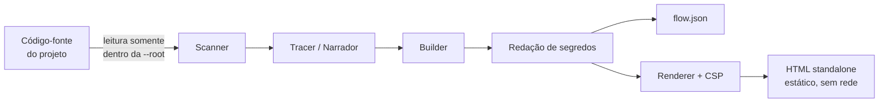

# Modelo de ameaças

Este documento descreve **o que o Flow View protege**, **contra quem** e **o que fica fora da proteção**. Ele complementa a [política de segurança](../SECURITY.md).

## 1. O que o Flow View faz (e não faz)



- **Não executa** o código analisado, **não instala** dependências do projeto-alvo, **não abre conexões de rede**.
- Escreve somente `flow.json` e o HTML nomeado pelo endpoint na pasta `--out`.
- Não tem telemetria.

## 2. Ativos

| Ativo | Por que importa |
| ----- | --------------- |
| Máquina e arquivos de quem roda a ferramenta | Não podem ser lidos/alterados por um repositório hostil |
| Segredos presentes no código analisado | Não podem vazar para o HTML compartilhado |
| Quem abre o HTML gerado | Não pode ser alvo de script malicioso vindo do código analisado |
| Integridade das releases | Usuários precisam confiar no que baixam |

## 3. Atores e premissas de confiança

| Ator | Confiança |
| ---- | --------- |
| Mantenedores | Confiáveis; protegidos por 2FA, commits assinados e rulesets |
| Pessoa que roda o CLI | Confiável (escolhe `--root`, `--out`) |
| **Código analisado** | **Não confiável** (pode ser de terceiros) |
| `flow.json` passado a `--render-only` | **Não confiável** (pode ter sido editado/gerado por outro) |
| Navegador do usuário | Confiável para aplicar a CSP |

## 4. Ameaças e controles

| # | Ameaça (STRIDE) | Controle | Onde / teste |
|---|-----------------|----------|--------------|
| T1 | **Elevação**: o código analisado executa algo na máquina | Análise estática; sem `eval`/`Function`; nenhum `import()` do alvo | revisão de código; `test/security.test.mjs` |
| T2 | **Divulgação**: leitura de arquivos fora do projeto (`../`, symlink) | `isInside()` com `realpath`; varredura não segue symlinks | `src/security.mjs`, `src/callee.mjs`, `src/scanner.mjs` · testes de path traversal e symlink |
| T3 | **Negação de serviço**: arquivo enorme, árvore profunda, regex catastrófica | Limites de tamanho/quantidade/profundidade; `escapeRegExp` nos padrões de rota | `src/security.mjs`, `src/scanner.mjs` · testes de limite |
| T4 | **Injeção (XSS)** no HTML gerado | Escape de todo texto; `<` escapado no JSON embutido; classes por lista permitida | `templates/viewer.html`, `src/renderer.mjs` · teste de payload malicioso |
| T5 | **Defesa em profundidade** se T4 falhar | CSP `default-src 'none'` + `script-src` por hash + `connect-src 'none'` | `src/renderer.mjs` · teste do hash da CSP |
| T6 | **Divulgação**: segredo literal no código vai para o HTML | Redação por formato e por nome (`password`, `api_key`…) | `src/redact.mjs` · `test/redact.test.mjs` |
| T7 | **Adulteração**: `--render-only` com JSON malformado | Validação estrutural + redação no renderizador | `assertFlowShape()` · teste |
| T8 | **Injeção de comando** ao abrir o navegador / `install.sh` | `spawn` sem shell; `install.sh` só copia arquivo e não usa rede | `bin/flow-view.mjs`, `install.sh` |
| T9 | **Supply chain**: dependência ou Action comprometida | Zero dependências; Actions fixadas por SHA; Dependabot; Dependency Review; `permissions` mínimas | `.github/` · `test/repo.test.mjs` |
| T10 | **Adulteração de release** | Release só de commit da `main`; tag == versão; proveniência SLSA; `SHA256SUMS` | `.github/workflows/release.yml` |
| T12 | **Negação de serviço** com PHP patológico (milhares de `(`/`{` aninhados, rotas/statements aos milhares) | Arquivo PHP com aninhamento > 120 é ignorado (varredura linear, sem recursão); índice de linhas em cache (sem tempo quadrático); no máximo 2.000 passos por diagrama; `vendor/` ignorado | `src/security.mjs`, `src/php/project.mjs`, `src/tracer.mjs` · testes de robustez em `test/laravel.test.mjs` |
| T13 | **Elevação** via parser PHP / skill: executar `php`, `artisan` ou `composer` do alvo | O parser PHP é próprio e estático; nenhuma dessas ferramentas é invocada; resolução de classes (PSR-4) confinada à raiz por `isInside()` | `src/php/*` · testes `segurança (php)` |
| T11 | **Prompt injection** em agentes que leem o `flow.json` | Aviso explícito no `SKILL.md` | `SKILL.md` |

## 5. Riscos residuais (assumidos)

1. **Redação é heurística.** Segredos em formatos incomuns podem passar. *Revise o HTML antes de compartilhar.*
2. **O HTML contém trechos do seu código.** Se o código é sigiloso, o HTML também é.
3. **Parsers por regex/heurística** podem interpretar mal construções raras; o efeito é um diagrama incorreto, não execução de código. Relate como bug.
4. A CSP via `<meta>` não pode definir `frame-ancestors`: se você hospedar o HTML, adicione cabeçalhos próprios (`frame-ancestors 'none'`, `X-Content-Type-Options: nosniff`).
5. Não protegemos contra alguém com acesso de escrita à pasta `--out` ou ao próprio HTML gerado.

## 6. Como validar (checklist para revisores)

```bash
npm run verify                       # sintaxe, versões, testes (incluem os casos T1–T10)
rg -n "eval\(|new Function|child_process" flow-view/   # só deve aparecer o spawn do navegador
node flow-view/bin/flow-view.mjs --root examples/sample-app --method POST --path /api/orders --out /tmp/out --no-open
grep -c "http-equiv=\"Content-Security-Policy\"" /tmp/out/*.html   # deve ser 1
```
